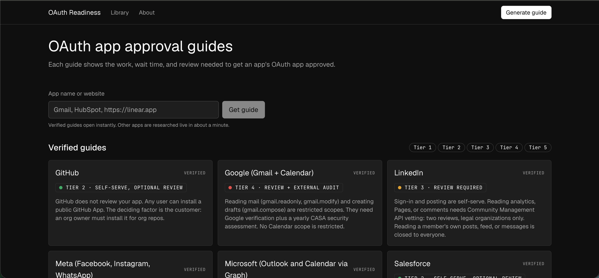

# OAuth Readiness

Understand what it takes to get your OAuth app ready for launch.

**Live app:** https://gauranga-oauth-readiness.vercel.app/

[](https://gauranga-oauth-readiness.vercel.app/)

## Problem

A developer building an AI agent can start with Composio's managed OAuth app. Before launch, they may need their own app and approval from the provider.

The setup is often straightforward. The wait is not. Security audits, partner programs, and customer admin approvals can turn an hour of work into months of waiting.

**OAuth Readiness helps developers understand the path before they build.** Enter an app name or website to get an actionable, shareable guide.

## What you get

Each guide covers:

- **Difficulty:** A tier from 1 (self-serve) to 5 (gated), based on approval requirements.
- **Time:** Hands-on work and waiting time, shown separately.
- **Requirements:** Checkable steps tagged Agent, You, or Provider.
- **Blockers:** Causes, fixes, and support resources.
- **Drafts:** Scope justifications, demo scripts, and admin emails.
- **Evidence:** Claims labelled Tested, Probed, Sourced, or Inferred, with sources and research dates.

Guides also explain how required OAuth scopes affect difficulty and whether a Composio managed app is available.

## Scope

The library contains seven verified guides covering different approval challenges.

| App | Tier | Main challenge |
|---|---|---|
| Google (Gmail + Calendar) | 4 | Annual third-party security audit |
| Meta | 3 | Business verification and permission reviews |
| Microsoft Outlook | 3 | Customer admin approval |
| LinkedIn | 3 | Restricted API access |
| Slack | 2 | History access rate limits |
| Salesforce | 2 | Customer org installations |
| GitHub | 2 | Organization owner approval |

Other apps are researched by a live agent, which generates a guide in about a minute.

I chose seven verified guides over 100 unchecked ones. The live agent covers apps outside the library.

## How it works

1. Enter an app name or website.
2. The agent searches official documentation, opens cited pages, probes OAuth endpoints with a fake client ID, and checks Composio's managed app directory.
3. It generates a guide in a fixed format. Invalid output gets one repair attempt.
4. Code validates evidence labels. A claim is Sourced only if its page was opened, and Probed only if the URL was tested.
5. The guide is saved at a shareable link.

The agent never signs in, creates accounts, or submits forms. Credentials, DNS, legal agreements, payments, and recordings remain the developer's responsibility.

## Validation

**Verified guides:** A second agent independently checked tier-deciding claims against their sources.

- 231 claims checked: 179 confirmed, 30 narrowed, 10 corrected, 12 unverified.
- Most issues were overstatements rather than incorrect facts.
- Corrections are documented in each guide and [verification/](verification/).

**Live agent:** See [docs/EVAL.md](docs/EVAL.md).

- Tier matched for 5 of 7 apps and was within one tier for all seven.
- Microsoft and LinkedIn were each rated one tier too easy.
- The agent missed important details about Google's test-user access and Meta's review requirements.

Prompt changes did not fix the tier errors. The verified guides got them right through deeper research and independent checks.

**Edge cases:** See [docs/LIVE_TESTS.md](docs/LIVE_TESTS.md). Websites, ambiguous names, API-key services, apps without public APIs, and invalid inputs were tested. None produced a fabricated guide.

Lessons and resulting changes are documented in [docs/LESSONS.md](docs/LESSONS.md).

No setup has been completed by a person, so no claim is marked Tested.

## Limitations

- Live guides are not independently verified.
- Waiting-time estimates rely on limited developer reports.
- Provider requirements change, and guides are not rechecked automatically.
- Rate limits are stored in memory per server instance.
- Without Upstash, live guide links do not persist across redeployments.

## Setup

```bash
npm install
cp .env.example .env.local
# Add ANTHROPIC_API_KEY
npm run dev
```

The app runs at `http://localhost:3000`.

- `MOCK_AGENT=1 npm run dev` runs a replay without API calls.
- `npm run generate -- "Notion"` generates a guide from the command line.
- `npm test`, `npm run lint`, `npm run build`, and `npm run check:secrets` run the checks.

**Deployment:** On Vercel, set `ANTHROPIC_API_KEY`. Add `UPSTASH_REDIS_REST_URL` and `UPSTASH_REDIS_REST_TOKEN` to persist share links. `GENERATION_DAILY_CAP` defaults to 50, with a limit of five live guides per hour per IP.

**Stack:** Next.js, TypeScript, Tailwind CSS, Zod, and the Anthropic SDK (`claude-sonnet-5-5`).